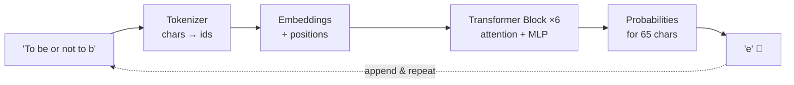
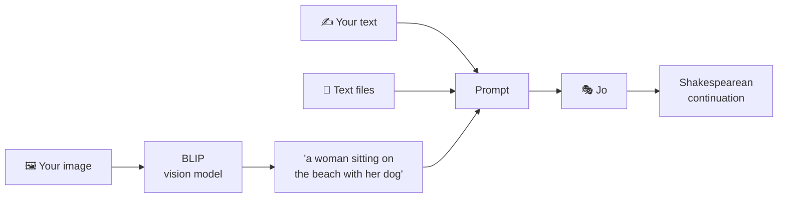

<div align="center">

# 🎭 Jo

### *A language model, built from scratch, that dreams in iambic nonsense.*

**10.8 million parameters · one laptop GPU · ten minutes of training · zero pretrained weights**


</div>

---

> ```
> JULIET:
> O Romeo, death! what art thou of man?
> Ah, and how may she be not for a shoulder there
> To be obey'd with us, I will not speak to thee,
> Ere thou shalt do say thou be at great to change.
> Come, come with words, come to me, my son,
> ```
> *— Jo, after ~4 minutes of training. Grammar: questionable. Drama: fully present.*

---

## 📜 Dramatis Personae

| | Character | Role in the play |
|---|---|---|
| 🧠 | **Jo** (`model.py`) | A GPT-style Transformer: 6 layers, 6 attention heads, 384-dimensional thoughts. Written line by line, no borrowed brains. |
| ✂️ | **The Tokenizer** (`tokenizer.py`) | Chops text into 65 characters and back. Humble, but no one speaks without it. |
| 🏋️ | **The Trainer** (`train.py`) | Shows Jo a million characters of Shakespeare and corrects every wrong guess, 5,000 times over. |
| 🪶 | **The Scribe** (`generate.py`) | Asks Jo, again and again: *"and what comes next?"* |
| 👁️ | **BLIP, a visiting seer** (`app.py`) | A pretrained vision model. Jo is blind, so BLIP looks at your pictures and describes them in words. |
| 🌐 | **The Stage** (`static/index.html`) | A web page where you talk to Jo and hand it images and text files. |

---

## 🎬 Act I: What is Jo?

Every large language model, from GPT-4 to Claude, is at heart a machine that answers one question:

<div align="center">

### *"Given this text… what comes next?"*

</div>

Jo is that machine, built by hand and small enough to understand completely. It uses the same architecture as the giants (**embeddings → stacked self-attention + MLP blocks → next-token prediction**), just about **16,000× smaller than GPT-3**.



| | **Jo** | GPT-2 small | GPT-3 |
|---|---|---|---|
| Layers | 6 | 12 | 96 |
| Attention heads | 6 | 12 | 96 |
| Embedding size | 384 | 768 | 12,288 |
| Context window | 256 chars | 1,024 tokens | 2,048 tokens |
| Parameters | **10.8 M** | 124 M | 175 B |
| Training hardware | one laptop | 32 TPUs | ~10,000 GPUs |

---

## 🎬 Act II: Summon Jo

```bash
git clone https://github.com/Youssefrajeh/Jo_LLM.git
cd Jo_LLM
pip install -r requirements.txt     # get the CUDA build of PyTorch from pytorch.org for GPU
```

A trained checkpoint is already included in `out/`, so Jo is ready to talk right away.

### 🌐 On the stage (the web app)

```bash
python app.py
```

Open **http://127.0.0.1:5000**. Then:

- ✍️ **Type** the start of a scene, like `ROMEO:`, and watch Jo continue it character by character
- 🖼️ **Drop an image**: BLIP describes it (*"a woman sitting on the beach with her dog"*) and Jo takes the stage from there
- 📄 **Drop a text file**: Jo continues from the end of it
- 🎚️ **Adjust** length, temperature (how bold Jo is) and top-k (how many choices it considers)
- 🔍 Expand **"What Jo actually saw"** to see the exact prompt the model received

> The first time you send an image, the app downloads BLIP (~1 GB) from Hugging Face.

### 🪶 In the terminal

```bash
python generate.py --prompt "ROMEO:" --tokens 500
python generate.py --prompt "HAMLET:" --temperature 1.2     # bolder
python generate.py --prompt "HAMLET:" --temperature 0.5     # safer
```

### 🏋️ Train your own Jo

```bash
python train.py                                   # ~10 min on an RTX 4050
python train.py --data my_diary.txt --out_dir out_diary
python generate.py --out_dir out_diary            # Jo, but it writes like you
```

---

## 🎬 Act III: The Education of Jo

Jo starts out knowing nothing. Its first loss is **4.30**, about what you'd expect from picking among 65 characters at random (ln 65 ≈ 4.17). Then it learns:

| Step | Val loss | What Jo "knows" |
|---:|---:|---|
| 0 | 4.30 | Nothing. Pure noise. |
| 50 | 2.49 | Spaces and common letters: `ANDIINI pro st theatar f y s y are ththe` |
| 500 | 1.71 | Words, line breaks, `NAME:` headers |
| **1750** | **1.46** ⭐ | Real words, meter, speakers, archaic grammar. **Best checkpoint.** |
| 5000 | 1.72 ↑ | Overfitting: it memorizes the training text and does *worse* on unseen text |

That last row is a lesson in itself: **train loss kept dropping, but validation loss rose again**. `train.py` only saves the checkpoint when validation loss improves, so the Jo you get is the one that generalizes best, not the one that memorized the most.

---

## 🎬 Act IV: Giving a Blind Poet Eyes

Jo only understands text. So how does it "see" your photos?



This **vision model → words → language model** pipeline is the simplest way to make a text model multimodal. Models like GPT-4o and Claude go further: they turn images into *embeddings* that the language model reads directly, without converting them to words first.

---

## 🎬 Act V: What Jo Is Not

Jo imitates Shakespeare's *style* without understanding a word of it. It can't answer questions, follow instructions or reason. Getting from Jo to a real assistant takes:

1. **Scale**: billions of parameters and trillions of words
2. **A better tokenizer**: BPE word-pieces instead of single characters
3. **Architecture upgrades**: RoPE, RMSNorm, SwiGLU, grouped-query attention
4. **Instruction tuning**: training on question → good-answer pairs
5. **RLHF**: reinforcement learning from human feedback

The foundation, though, is exactly what's in `model.py`.

📖 **For the full walkthrough of every component, read [`EXPLANATION.md`](EXPLANATION.md).**

---

## 🗂️ The Script (project layout)

```
Jo_LLM/
├── model.py          🧠 the Transformer (commented for study)
├── tokenizer.py      ✂️ characters ↔ ids
├── train.py          🏋️ training loop: AdamW, warmup + cosine LR, bf16, checkpoints
├── generate.py       🪶 text generation from the command line
├── app.py            🌐 Flask server: Jo + BLIP, streaming responses
├── static/index.html 🎭 the web page
├── data/input.txt    📚 Tiny Shakespeare (1.1 MB)
├── out/              💾 trained checkpoint + vocabulary
├── train_log.txt     📈 the training run, step by step
└── EXPLANATION.md    📖 the full lesson
```

---

## 🙏 Curtain Call

- Vaswani et al., [*Attention Is All You Need*](https://arxiv.org/abs/1706.03762) (2017), the Transformer
- Radford et al., [*Language Models are Unsupervised Multitask Learners*](https://cdn.openai.com/better-language-models/language_models_are_unsupervised_multitask_learners.pdf) (2019), GPT-2
- Li et al., [*BLIP*](https://arxiv.org/abs/2201.12086) (2022), the seer who lends Jo its eyes
- Andrej Karpathy's [nanoGPT](https://github.com/karpathy/nanoGPT) and *Let's build GPT*, which inspired this project's design
- William Shakespeare, for the training data (unpaid)

<div align="center">

---

*"All the world's a stage, and all the men and women merely* ***tokens****."*

**Built by Youssef Rajeh** · Emerging Technologies, Semester 6

</div>
