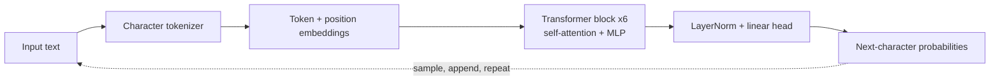
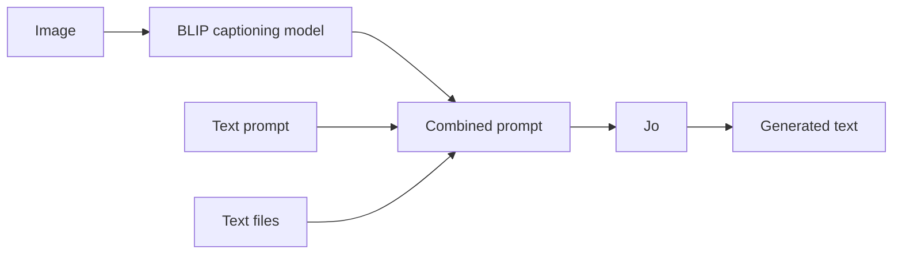
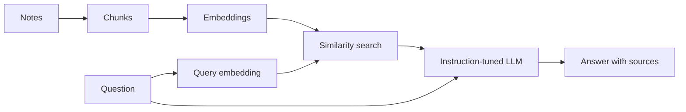

# Jo

A small GPT-style language model implemented from scratch in PyTorch, trained on the works of Shakespeare, and served through a local web interface that accepts text, text files, and images.

The project also includes two private, fully local assistants that illustrate how pretrained models are adapted to personal data: a code model fine-tuned on your own code with LoRA, and a retrieval-augmented (RAG) assistant that answers questions from your notes.

| | |
|---|---|
| Parameters | 10.8 million |
| Architecture | Decoder-only Transformer (6 layers, 6 heads, 384-dim embeddings) |
| Training data | Tiny Shakespeare (1.1 MB) |
| Training time | ~12 minutes on an NVIDIA RTX 4050 Laptop GPU |
| Pretrained weights | None (trained from random initialization) |

## Overview

Every large language model is trained on the same objective: given a sequence of text, predict the next token. Jo implements that objective end to end, with the same core architecture as GPT-2 and GPT-3 (token and position embeddings, stacked self-attention and MLP blocks, and a next-token output layer), at a scale small enough to train on a laptop and to read in full.

Sample output (prompt: `JULIET:\nO Romeo,`):

```
JULIET:
O Romeo, death! what art thou of man?
Ah, and how may she be not for a shoulder there
To be obey'd with us, I will not speak to thee,
Ere thou shalt do say thou be at great to change.
```

The model reproduces the structure of the source text (speaker names, verse line breaks, archaic vocabulary) without any understanding of its meaning.

## Architecture



| | Jo | GPT-2 small | GPT-3 |
|---|---|---|---|
| Layers | 6 | 12 | 96 |
| Attention heads | 6 | 12 | 96 |
| Embedding size | 384 | 768 | 12,288 |
| Context window | 256 characters | 1,024 tokens | 2,048 tokens |
| Parameters | 10.8M | 124M | 175B |

Implementation details:

- Causal multi-head self-attention (PyTorch fused scaled dot-product attention)
- Pre-LayerNorm residual blocks with GELU MLPs
- Weight tying between the input embedding and output layer
- AdamW with decoupled weight decay, linear warmup and cosine learning-rate decay
- bfloat16 mixed precision and gradient clipping
- Checkpointing on best validation loss

## Getting Started

```bash
git clone https://github.com/Youssefrajeh/Jo_LLM.git
cd Jo_LLM
pip install -r requirements.txt
```

For GPU support, install the CUDA build of PyTorch from [pytorch.org](https://pytorch.org). A trained checkpoint is included in `out/`, so no training is required to run the model.

### Web interface

```bash
python app.py
```

Then open http://127.0.0.1:5000. The interface supports:

- Text prompts, with the generated output streamed as it is produced
- Text file uploads, used as the prompt
- Image uploads, converted to a caption by a vision model before being passed to Jo
- Adjustable output length, temperature, and top-k sampling
- An inspection panel showing the exact prompt the model received

The image captioning model (~1 GB) is downloaded from Hugging Face on first use.

### Command line

```bash
python generate.py --prompt "ROMEO:" --tokens 500
python generate.py --prompt "HAMLET:" --temperature 0.5 --top_k 20
```

### Training

```bash
python train.py                                    # default: Tiny Shakespeare, 5,000 steps
python train.py --data corpus.txt --out_dir out_corpus
python generate.py --out_dir out_corpus
```

All hyperparameters (model size, context length, batch size, learning rate, dropout) are configurable via command-line arguments. See `python train.py --help`.

## Results

| Step | Train loss | Validation loss |
|---:|---:|---:|
| 0 | 4.30 | 4.30 |
| 500 | 1.53 | 1.71 |
| 1,000 | 1.26 | 1.51 |
| 1,750 | 1.09 | **1.46** (best) |
| 3,000 | 0.84 | 1.54 |
| 5,000 | 0.58 | 1.72 |

The initial loss matches uniform guessing over the 65-character vocabulary (ln 65 ≈ 4.17). Validation loss reached its minimum at step 1,750 and increased afterwards while training loss continued to fall, indicating overfitting on the 1.1 MB dataset. The included checkpoint is the step-1,750 model. The full log is in `train_log.txt`.

## Multimodal Input

Jo is a text-only model. Images are handled by a separate pretrained captioning model, [BLIP](https://arxiv.org/abs/2201.12086) (`Salesforce/blip-image-captioning-base`), whose output is added to the prompt:



This pipeline is the simplest way to extend a text model to images. Production multimodal models instead project image features directly into the language model's embedding space.

## Personal Assistants

Both assistants run entirely on the local machine and are available as tabs in the web interface ("My code" and "My notes"). All personal data, and anything derived from it, is stored in `private/`, which is excluded from version control.

### Coding style (LoRA fine-tuning)

`code_style.py` adapts [Qwen2.5-Coder-0.5B](https://huggingface.co/Qwen/Qwen2.5-Coder-0.5B) to a user's own code. Training a small model such as Jo on code would reproduce its surface form without producing working programs, so this uses transfer learning from a pretrained code model instead. [LoRA](https://arxiv.org/abs/2106.09685) freezes the base weights and trains low-rank updates to each attention and MLP projection (8.8M trainable parameters, 1.7% of the model), which fits in 6 GB of GPU memory with bfloat16 and gradient checkpointing.

```bash
python code_style.py train --code_dir "path/to/your/projects"
python code_style.py complete --prompt "def load_users(path):" --compare
```

The collector skips dependency folders, build output, minified files, and credential files such as `.env`. The `--compare` flag prints the base model's completion alongside the fine-tuned one.

### Notes (retrieval-augmented generation)

`notes_rag.py` answers questions from `.txt` and `.md` files in `private/notes/`. Facts are not trained into model weights, where they would be recalled unreliably and could not be removed. Instead, notes are split into chunks, embedded with [bge-small-en-v1.5](https://huggingface.co/BAAI/bge-small-en-v1.5), retrieved by cosine similarity, and passed to [Qwen2.5-1.5B-Instruct](https://huggingface.co/Qwen/Qwen2.5-1.5B-Instruct) with instructions to answer only from the retrieved text.



```bash
python notes_rag.py ask "When is my dentist appointment?"
python notes_rag.py ask "Which days do I go to the gym?" --notes_dir examples/notes
```

The index is rebuilt automatically when a note is added, edited, or deleted. Fictional sample notes are provided in `examples/notes/`. On these, the assistant answered every question whose answer was present correctly, and replied that the information was not in the notes when it was not.

## Limitations

Jo models the surface statistics of its training text. It does not answer questions, follow instructions, or reason. The main differences from production language models are:

1. Scale: billions of parameters trained on trillions of tokens
2. Tokenization: subword (BPE) vocabularies rather than characters
3. Architecture refinements: rotary position embeddings, RMSNorm, SwiGLU, grouped-query attention
4. Post-training: supervised instruction tuning and reinforcement learning from human feedback

## Project Structure

```
Jo_LLM/
├── model.py           Transformer implementation
├── tokenizer.py       Character-level tokenizer
├── train.py           Training loop
├── generate.py        Command-line text generation
├── app.py             Flask server (Jo, BLIP, code and notes assistants; streaming)
├── static/index.html  Web interface
├── code_style.py      LoRA fine-tuning of a code model on your code
├── notes_rag.py       Retrieval-augmented question answering over your notes
├── examples/notes/    Fictional sample notes
├── data/input.txt     Training data
├── out/               Trained checkpoint and vocabulary
├── train_log.txt      Training log
├── EXPLANATION.md     Detailed walkthrough of every component
└── private/           Your notes, index, and adapter (git-ignored)
```

A step-by-step explanation of the tokenizer, attention mechanism, training procedure, web application, LoRA fine-tuning, and retrieval pipeline is available in [EXPLANATION.md](EXPLANATION.md).

## References

- Vaswani et al., [Attention Is All You Need](https://arxiv.org/abs/1706.03762), 2017
- Radford et al., [Language Models are Unsupervised Multitask Learners](https://cdn.openai.com/better-language-models/language_models_are_unsupervised_multitask_learners.pdf), 2019
- Li et al., [BLIP: Bootstrapping Language-Image Pre-training](https://arxiv.org/abs/2201.12086), 2022
- Hu et al., [LoRA: Low-Rank Adaptation of Large Language Models](https://arxiv.org/abs/2106.09685), 2021
- Lewis et al., [Retrieval-Augmented Generation for Knowledge-Intensive NLP Tasks](https://arxiv.org/abs/2005.11401), 2020
- Karpathy, [nanoGPT](https://github.com/karpathy/nanoGPT)

## Author

Youssef Rajeh, Emerging Technologies, Semester 6
